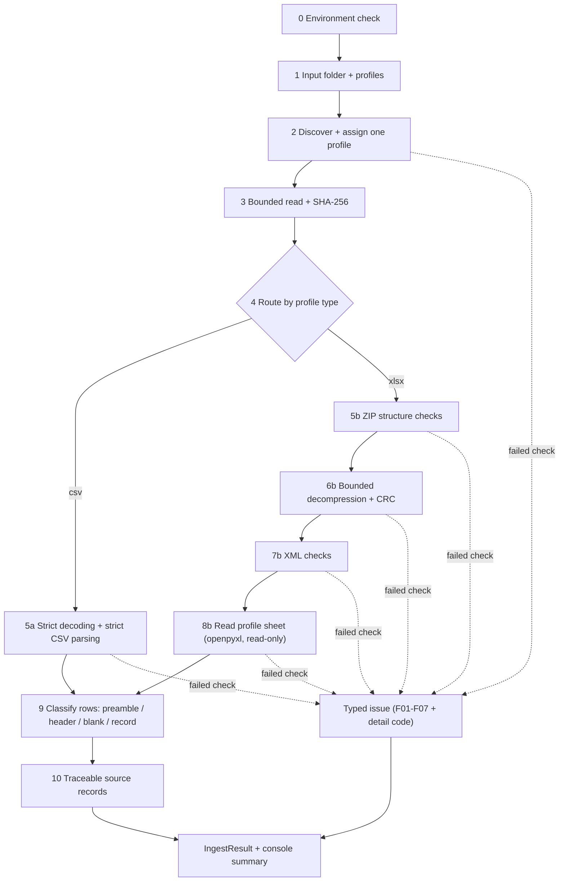

# Small Business Reporting Automation

**Validated, traceable ingestion of CSV and Excel sales files for multi-branch retailers.**

> **Project status:** the **ingestion stage** is implemented and tested. Normalization, business rules, consolidation and report generation are **planned but not implemented**. This is a portfolio case study built on synthetic data, not a finished reporting platform and not hardened for arbitrary or production files.

## The problem

Retailers with several branches often receive their monthly sales as loose files: a web-shop CSV, one Excel workbook per branch, each with its own layout (semicolon or comma separators, different text encodings, title rows above the table, differently named sheets). Merging them by hand is slow and error-prone, and a corrupted file can silently distort the numbers.

## What is implemented

A command-line tool (`sb-report`) whose ingestion stage:

- discovers files in a folder (non-recursive; hidden, temporary and symlinked entries are ignored) and assigns each one to **exactly one configurable source profile** (format, sheet, header row, encoding, delimiter);
- reads **CSV** with strict decoding and strict parsing, and **Excel (.xlsx)** with container validation (entry count, names, duplicates, encryption, ranges, bounded decompression with CRC checks, no `DOCTYPE`, UTF-8 only, row/cell structure pre-scan);
- **rejects** files that trip the implemented checks with a stable error code and message, discarding that file's records, and continues with the remaining files on the tested paths;
- delivers **traceable source rows**: file, sheet, row, physical line (CSV), a stable record id and a SHA-256 of each file. Values are delivered uninterpreted.

Configuration validation and a deterministic synthetic-data generator with expected results are also included.

## Architecture



## Technologies

Python 3.12 · standard library (`csv`, `zipfile`, `zlib`, `pyexpat`) · `openpyxl` · `uv` · `pytest`. (`pandas` is declared for future consolidation stages; ingestion does not use it.)

## Quick start

Requirements: Linux (developed on WSL2 Ubuntu 24.04), Python 3.12 and [`uv`](https://docs.astral.sh/uv/).

```sh
git clone <repository-url>
cd small-business-reporting-automation
uv sync --locked
```

### Run the demo (synthetic data)

```sh
uv run sb-report ingest
```

Real output (2026-11-23):

```
archivo                            estado    perfil       filas prea. cab. blanc. regs.  detalle
centro_ventas_2026-10.csv          ingested  centro-csv      54     0    1      0    53  sha256=af7949ffae45…
norte_ventas_2026-10.xlsx          ingested  norte-xlsx      59     2    1      1    55  sha256=e32512a68d4f…
sur_ventas_2026-10_tienda.xlsx     ingested  sur-xlsx        36     0    1      1    34  sha256=56b87e8df72f…
sur_ventas_2026-10_web.csv         ingested  sur-csv         37     0    1      1    35  sha256=32845ea84b9b…

Ingesta completada: 4 archivos aceptados, 0 rechazados, 177 registros de origen.
```

Column headers and messages are printed in Spanish. Rows: physical rows read; `prea.`: preamble rows; `cab.`: header row; `blanc.`: blank rows; `regs.`: source records delivered.

### See a controlled rejection

```sh
mkdir /tmp/demo && cp data/raw/* /tmp/demo/
printf 'this is not an Excel file' > /tmp/demo/norte_ventas_2026-11.xlsx
uv run sb-report ingest --input-dir /tmp/demo
```

The valid files are still accepted and the broken one is reported as `rejected` with `F01 zip_unreadable`. (Other defect types, such as malformed CSV quoting, invalid bytes for the declared encoding or an XML `DOCTYPE`, are covered by the tests.)

### Run the tests

```sh
uv run pytest
```

Last recorded run (2026-11-23): **384 passed, 0 failed**; 69 of them cover ingestion, including adversarial cases built in memory (truncated or random ZIPs, unsafe entry names, overlapping ranges, declared sizes that disagree with real decompressed sizes, XML with `DOCTYPE`, UTF-16 XML, rows out of order, limit checks). One test compares the ingestion of the demo data with independently generated expected results, record by record. This is evidence for the covered cases, not a security certification.

## Limitations

- Only the ingestion stage exists; the output is uninterpreted source rows and a console summary. No reports or KPIs.
- Tested on synthetic data only.
- ZIP/ZIP64 validation needs further hardening, and some exceptions raised while reading XLSX files may propagate instead of becoming an isolated per-file rejection; a malformed file therefore cannot be guaranteed to let a batch continue. Not ready for arbitrary files or production use without hardening and independent review.
- Memory and run time have not been measured on large or adversarial files.
- Only `.csv` and `.xlsx` (the extension is case-sensitive); one sheet per profile; a blank row is one whose cells are all empty or whitespace; totals rows are delivered as ordinary source rows.
- Linux only (WSL2 tested); no CI yet.

## Roadmap

1. Normalization of columns, dates and amounts.
2. Configurable business rules with per-record issues.
3. Consolidation across branches and KPIs.
4. Report export and issue log files; a complete `run` command.
5. Performance measurements, hardening review and tests with anonymized real-world files.

## License

No license is granted for reuse, modification, or redistribution of this code. All rights reserved, except for rights provided by GitHub's applicable terms and applicable law.
